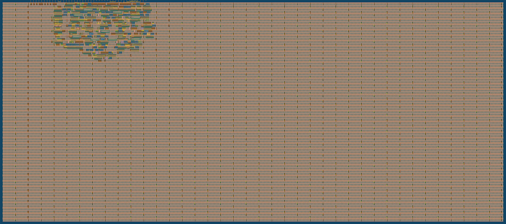
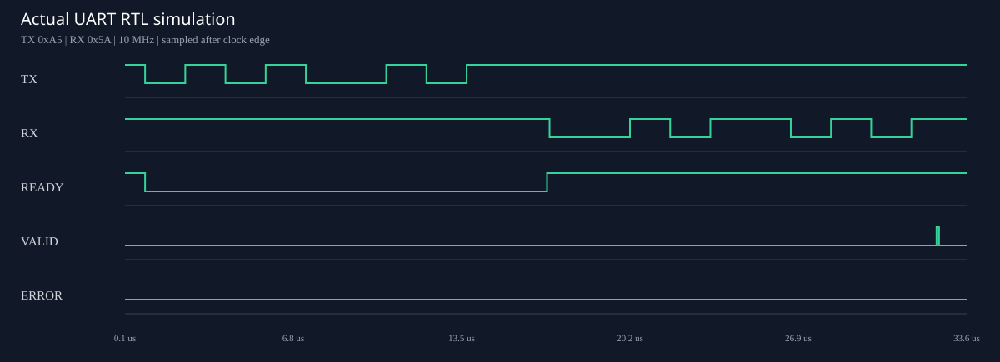

# SKY130 UART ASIC — RTL to GDSII


An independent, AI-assisted end-to-end ASIC development
and verification project implementing a UART transmitter
and receiver in SKY130 130 nm technology.

**Status: Official provider precheck passed.
Fabrication acceptance and silicon testing remain open.**

## Physical ASIC layout



## Project specifications

| Parameter | Value |
|---|---|
| Design | UART TX and RX |
| Process | SKY130 |
| Tiles | 3x2 |
| Macro | 508.760 x 225.760 um |
| Target clock | 10 MHz |
| Baud rate | 625000 |
| UART format | 8N1 |
| STA corners | 9 |
| Official precheck | 17/17 PASS |
| Formal equivalence | 24 output bits |
| Documentation workflow | NOT VERIFIED |

## Engineering achievements

- RTL design and functional verification.
- SystemVerilog testbenches and assertion testing.
- Logic synthesis and structural verification.
- Floorplanning, PDN, placement and CTS.
- Global and detailed routing.
- Targeted ECO optimization.
- Nine-corner static timing analysis.
- Local DRC and LVS.
- Unbounded reset-conditioned formal equivalence.
- Independent power-grid connectivity analysis.
- Official Tiny Tapeout precheck: 17/17 PASS.

## Functional simulation



[Simulation log, testbench and VCD](portfolio/simulation/)

## Engineering portfolio

| Section | Documentation |
|---|---|
| Architecture | [UART block diagram](portfolio/ARCHITECTURE.md) |
| Technical report | [ASIC engineering report](portfolio/ASIC_DESIGN_REPORT.md) |
| Formal and timing evidence | [Local verification](portfolio/verification/local/) |
| Provider checks | [Official evidence](portfolio/verification/official/) |
| Reproducibility | [Toolchain and methodology](portfolio/reproducibility/) |
| Development history | [Original RTL-DV lab](https://github.com/vaish-machine/rtl-dv-lab/tree/e2c612a965548cc12c411957594874496a0d8a8e/asic_tapeout) |

## Toolchain

SystemVerilog, Icarus Verilog, Yosys, ABC,
LibreLane, OpenROAD, OpenSTA, Magic, KLayout,
Netgen, Python, Linux and GitHub Actions.

## Verified manufacturing revision

- [Official successful precheck](https://github.com/vaish-machine/ttsky-uart-asic/actions/runs/45433759245)
- [Documentation workflow](https://github.com/vaish-machine/ttsky-uart-asic/actions/workflows/docs.yaml)
- [Frozen manufacturing commit](https://github.com/vaish-machine/ttsky-uart-asic/commit/5ae3cfc4481abf22cda836ca8179ee21ce64b305)

GDS SHA256:

```
1c0d442e99115f6e1bc2aa7a0dc7dc41c99550dc2488816f3959a714b33dd6a8
```

## Artifact integrity

```bash
sha256sum --check RELEASE_SHA256SUMS.txt
```

The original local signoff record is a historical
snapshot. The subsequent official provider result
is recorded separately in the engineering portfolio.

## Scope

This project demonstrates verified RTL-to-GDSII
implementation and tapeout preparation.

It does not claim completed fabrication, silicon
measurements or production qualification.

## License

Apache-2.0.
