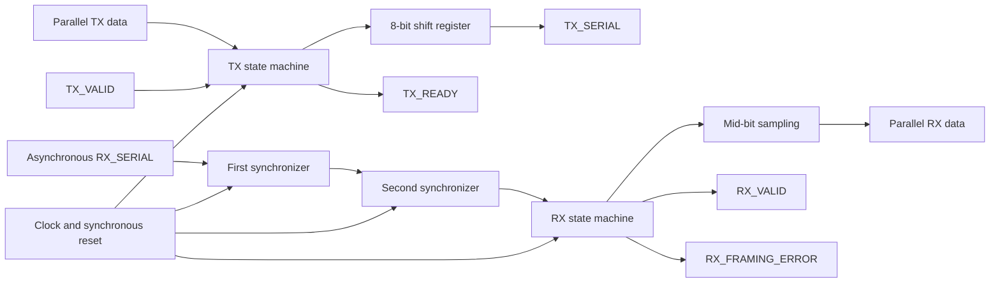

# SKY130 UART architecture

## Design characteristics

- 8N1 UART, LSB first.
- 16 clocks per bit.
- 625000 baud at 10 MHz.
- Synchronous active-low reset.
- Two-flop RX synchronizer.
- Stop-bit validation and framing-error reporting.
- No FIFO or hardware flow control.

The synchronizer is not a quantitative metastability
reliability guarantee.

See [provider pinout](../docs/info.md).
