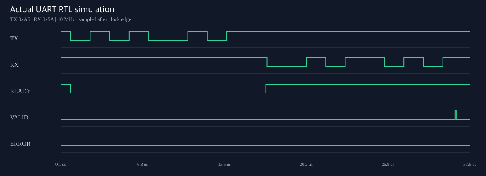
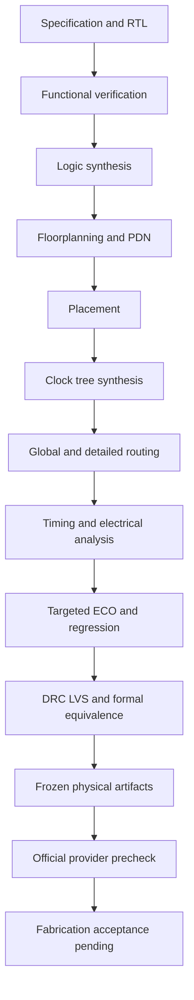
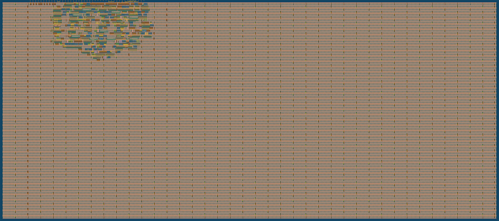

# SKY130 UART ASIC
## Engineering Design and Verification Report

### Executive summary

Independent, AI-assisted RTL-to-GDSII implementation
and verification of an 8-bit UART transmitter and receiver.

The design passed all 17 official Tiny Tapeout
prechecks. Fabrication acceptance and measured silicon
functionality are not claimed.

### Design specification

| Parameter | Value |
|---|---|
| Process | SKY130, 130 nm |
| Tile allocation | 3x2 |
| Macro dimensions | 508.760 x 225.760 um |
| Clock target | 10 MHz |
| Baud rate | 625000 |
| UART protocol | 8N1 |
| Reset | Synchronous active low |

### System architecture

See [architecture](ARCHITECTURE.md).

### Functional verification

The historical project contains directed, stress,
reset-matrix, asynchronous RX phase, assertion and
formal safety verification.

The current portfolio includes a fresh self-checking
wrapper simulation against the exact release RTL.

### RTL-to-GDSII methodology

### Physical and formal verification

| Metric | Result |
|---|---|
| Local DRC errors | 0 |
| Local LVS errors | 0 |
| Reported setup violations | 0 |
| Reported hold violations | 0 |
| Maximum slew violations | 0 |
| Nine-corner STA | PASS |
| Formal equivalence | 24 output bits |
| Worst register-to-register setup slack | +94.382515 ns |
| Worst register-to-register hold slack | +0.110787 ns |
| VPWR explicit connections | 30979 |
| VGND explicit connections | 30979 |

These results are local pre-silicon analyses under
the recorded constraints, not silicon measurements.

### ECO and debugging

The final implementation used a targeted buffer ECO
to resolve a remaining electrical slew violation.

Formal equivalence, timing and physical verification
were repeated on the corrected implementation.

The initial provider check failed because a logical
netlist without explicit power connections was supplied.
The original native powered netlist corrected the
submission package without changing the GDS or RTL.

### Official provider verification

[Successful precheck workflow](https://github.com/vaish-machine/ttsky-uart-asic/actions/runs/45433759245)

| Check | Result |
|---|---|
| Magic DRC | PASS |
| KLayout FEOL | PASS |
| KLayout BEOL | PASS |
| KLayout offgrid | PASS |
| KLayout pin label overlapping drawing | PASS |
| KLayout zero area | PASS |
| KLayout Checks | PASS |
| Pin check | PASS |
| Boundary check | PASS |
| Power pin check | PASS |
| Layer check | PASS |
| Cell name check | PASS |
| urpm/nwell check | PASS |
| hvtp/nwell check | PASS |
| lvtn/nwell check | PASS |
| Analog pin check | PASS |
| Verilog syntax check | PASS |

Documentation workflow:
[NOT VERIFIED](https://github.com/vaish-machine/ttsky-uart-asic/actions/workflows/docs.yaml)

### Physical layout

### Engineering evidence

- [Local reports](verification/local/)
- [Official reports](verification/official/)
- [Simulation evidence](simulation/)
- [Reproduction instructions](reproducibility/)
- [Historical implementation scripts](https://github.com/vaish-machine/rtl-dv-lab/tree/e2c612a965548cc12c411957594874496a0d8a8e/asic_tapeout)

### Remaining limitations

- Final shuttle assignment and provider acceptance.
- Fabrication submission and payment.
- Board-level controller and pad timing.
- Quantitative CDC metastability MTBF.
- Portable bit-identical physical rebuild.
- Fabrication and measured silicon validation.

### Planned silicon bring-up

Test reset and idle levels, transmit and receive frames,
framing errors, repeated transactions, reset recovery,
and TX-to-RX loopback.

No hardware measurements are claimed in this report.
