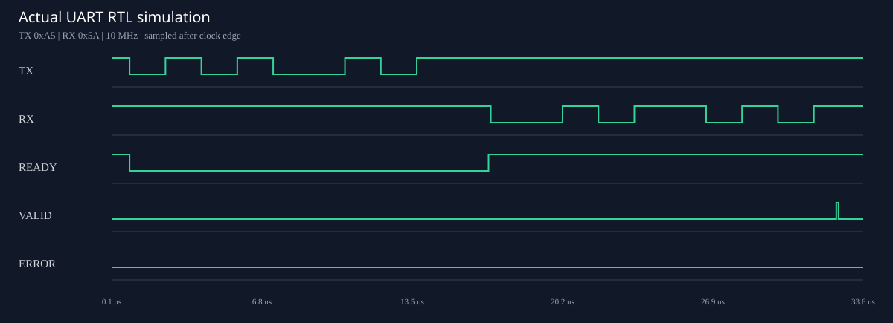

# Functional RTL simulation

The simulation was executed against the exact release RTL.

- TX test byte: 0xA5.
- RX test byte: 0x5A.
- Clock: 10 MHz.
- Format: 8N1.

The historical self-checking testbench was instrumented
to capture VCD and sampled signal data.

Open `uart-wrapper.vcd` in GTKWave for full signal detail.

The SVG is derived from actual simulator samples, not
an illustrative or manually fabricated waveform.

See `simulation.log` and `evidence.json` for the result.
